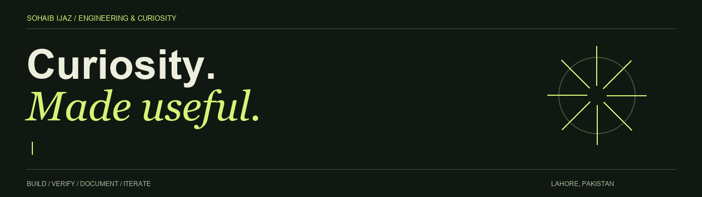
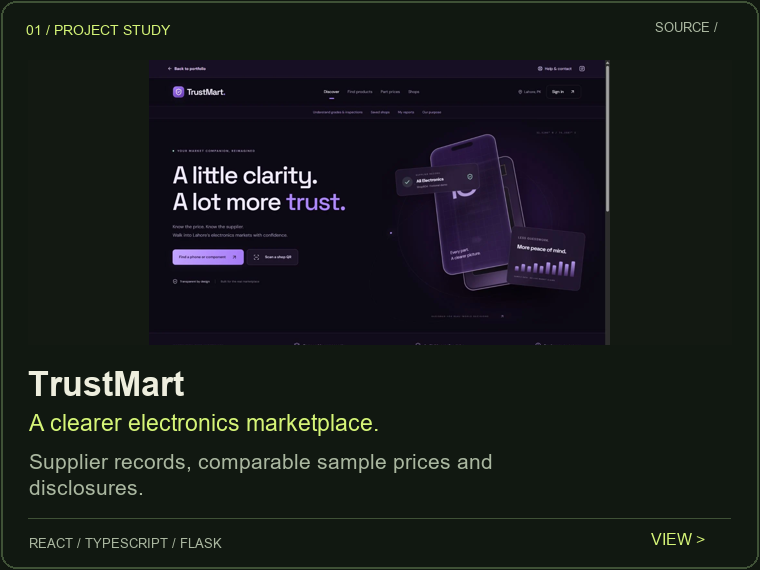
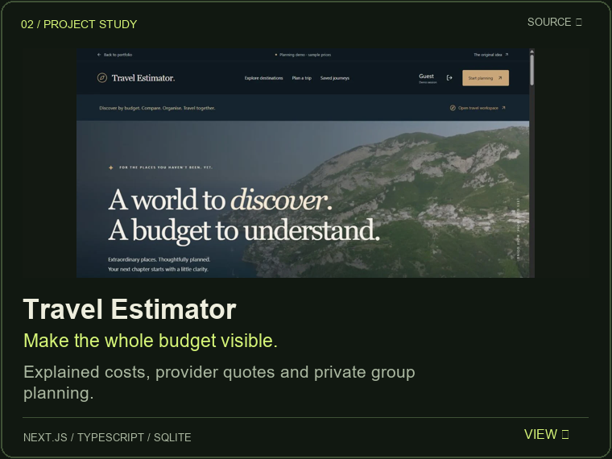
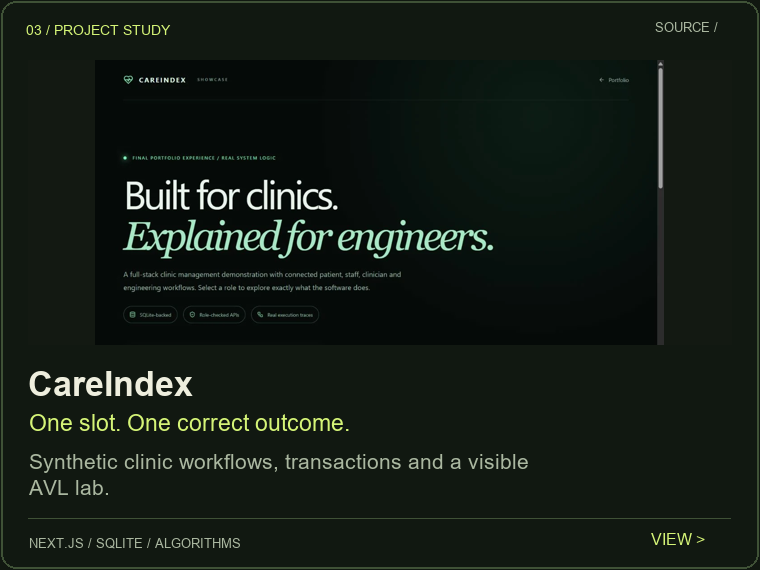
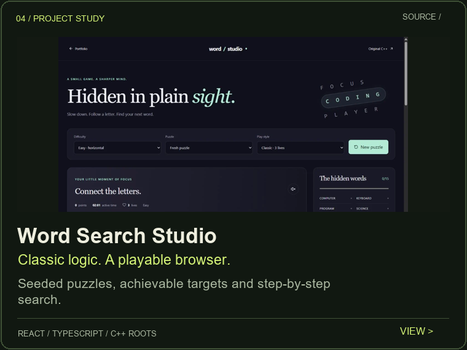
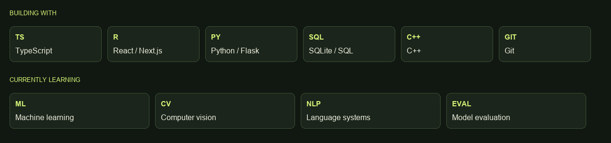
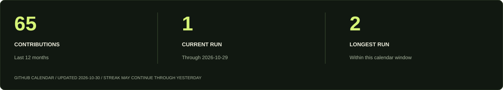

<picture>
  <source media="(prefers-reduced-motion: reduce) and (prefers-color-scheme: light)" srcset="assets/header-light-static.png">
  <source media="(prefers-reduced-motion: reduce)" srcset="assets/header-dark-static.png">
  <source media="(prefers-color-scheme: light)" srcset="assets/header-light.gif">
  
</picture>

# Hi, I'm Sohaib Ijaz

**BS Computer Science · UCP, Lahore · Class of 2027**

I turn small, working ideas into software you can inspect—and explain the decisions underneath.

[Live portfolio](https://sohaibijaz.dev) · [Source & setup](https://github.com/sohaibijaz940/sohaib-engineering-portfolio) · [Engineering writing](https://sohaibijaz.dev/writing/) · [LinkedIn](https://www.linkedin.com/in/sohaibijaz) · [Email](mailto:sohaibijaz1234@gmail.com)

<picture>
  <source media="(prefers-color-scheme: light)" srcset="assets/evidence-light.png">
  
</picture>

## Selected builds

Four different problems. A shared approach: make the data, rules and assumptions visible. Each card opens the live demo; the original coursework and its history remain linked from the project repositories.

<a href="https://trustmart.sohaibijaz.dev/">
<picture>
  <source media="(prefers-color-scheme: light)" srcset="assets/project-trustmart-light.png">
  
</picture>
</a>
<a href="https://sohaibijaz.dev/demos/travel/">
<picture>
  <source media="(prefers-color-scheme: light)" srcset="assets/project-travel-light.png">
  
</picture>
</a>

<a href="https://sohaibijaz.dev/demos/careindex/tour/">
<picture>
  <source media="(prefers-color-scheme: light)" srcset="assets/project-careindex-light.png">
  
</picture>
</a>
<a href="https://sohaibijaz.dev/demos/word-search/">
<picture>
  <source media="(prefers-color-scheme: light)" srcset="assets/project-word-search-light.png">
  
</picture>
</a>

**Foundations:** [TrustMart](https://github.com/sohaibijaz940/trustmart-project) · [Travel database](https://github.com/sohaibijaz940/dynamic-travel-cost-estimator) · [Patient-ID AVL tree](https://github.com/sohaibijaz940/Patient-Record-AVL-Tree) · [C++ word search](https://github.com/sohaibijaz940/wordsearchgame)

## Tools & the next chapter

<picture>
  <source media="(prefers-color-scheme: light)" srcset="assets/skills-light.png">
  
</picture>

My current foundation is software engineering, algorithms and databases. Machine learning is the next chapter: understanding the models, evaluating them carefully and finding useful problems to solve.

## Behind the build

I document more than the finished screen. The portfolio includes six illustrated walkthroughs, with working teaching examples and four short English explainers with captions and transcripts.

- [TrustMart: which prices should count?](https://sohaibijaz.dev/writing/trustmart-from-scanner-to-market-companion/)
- [Travel: what does a quote actually replace?](https://sohaibijaz.dev/writing/travel-estimator-live-quotes-explained/)
- [CareIndex: two requests, one appointment.](https://sohaibijaz.dev/writing/careindex-booking-conflicts-and-transactions/)
- [Word Search: a puzzle should be possible to finish.](https://sohaibijaz.dev/writing/word-search-solvable-seeded-puzzles/)

[Browse all writing](https://sohaibijaz.dev/writing/) · [Certificates & issuer information](https://sohaibijaz.dev/#certificates) · 

## The work, over time

<picture>
  <source media="(prefers-color-scheme: light)" srcset="assets/generated/activity-light.svg">
  
</picture>

These are actual GitHub calendar values for the last twelve months, refreshed daily. The current run may continue through yesterday while today is still in progress.

<picture>
  <source media="(prefers-reduced-motion: reduce) and (prefers-color-scheme: light)" srcset="assets/generated/calendar-light-static.svg">
  <source media="(prefers-reduced-motion: reduce)" srcset="assets/generated/calendar-dark-static.svg">
  <source media="(prefers-color-scheme: light)" srcset="assets/generated/snake-light.svg">
  
</picture>

Contribution animation: [Platane/snk](https://github.com/Platane/snk). Dark/light artwork follows your appearance preference; motion artwork has static reduced-motion alternatives. [Activity source and refresh workflow](.github/workflows/profile-artwork.yml).

---

**Open to internships, junior software roles and thoughtful collaborations.**

[Let's talk](mailto:sohaibijaz1234@gmail.com) · [Explore the source](https://github.com/sohaibijaz940/sohaib-engineering-portfolio)

The portfolio and four demos are live at sohaibijaz.dev. Shops, clinic records and hotel examples are fictional; provider responses and sample assumptions remain labelled. No real payments or clinical services.
